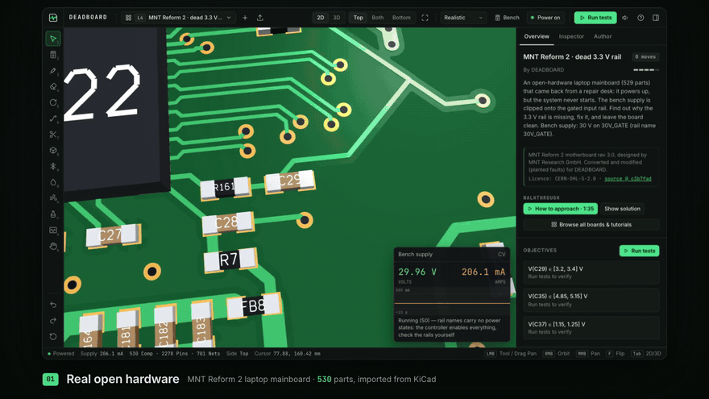

<p align="center">
  
</p>

<p align="center">
  <b>Trenażer naprawy elektroniki na poziomie komponentów · Board-level repair trainer.</b><br>
  Diagnozuj i naprawiaj symulowane płytki drukowane na realistycznym stole warsztatowym w przeglądarce.
</p>

<p align="center">
  
</p>

<p align="center">
  <b><a href="./app.html">▶ Uruchom warsztat w przeglądarce</a></b> ·
  <a href="https://github.com/merx666/deadboard">Repozytorium GitHub</a> ·
  <a href="./rea-analysis/REA_ANALYSIS_REPORT.md">Raport Inżynierii Wstecznej REA</a>
</p>

---

## 🇵🇱 O Projekcie (Polski — domyślny)

**DEADBOARD** kładzie uszkodzoną płytkę drukowaną na Twoim stole warsztatowym i oddaje w Twoje ręce pełen zestaw przyrządów pomiarowych technika elektronika. 
Mierzysz, analizujesz schemat ideowy, wykonujesz rework i weryfikujesz naprawę. Obwód jest rozwiązywany przez rzeczywisty silnik symulacji typu **SPICE / MNA**, więc mierniki wskazują prawdziwe stany fizyczne obwodu, a nie z góry oskryptowane odpowiedzi.

### 🛠️ Główne Funkcje i Przyrządy
- **Prawdziwe przyrządy laboratoryjne**:
  - **Multimetr cyfrowy**: 6000 zliczeń, napięcie DC (V), rezystancja (Ω), test diody, pojemność (nF/µF), amperomierz w szeregu (10 A).
  - **Akustyczny brzęczyk ciągłości (Buzzer)**: autentyczny sygnał piezoelektryczny 2.7 kHz przy rezystancji poniżej 30 Ω i zwartych złączach półprzewodnikowych.
  - **Zasilacz laboratoryjny**: odczyt prądu rozruchu (standby, sleep, boot loop), nastawa limitu prądowego OCP oraz wstrzykiwanie napięcia (Voltage Injection: 1 V / 3.3 V) na zwarte linie zasilania.
  - **Oscyloskop cyfrowy**: tryb Roll do badania ramp zasilania, kluczowania przetwornic DC-DC, tętnień szyn i generatorów zegarowych.
  - **Kamera termowizyjna**: fizyczny model promieniowania IR, emisyjność lutowia, zamrażacz w sprayu, alkohol izopropylowy (IPA) i metoda kalafoniowa.
- **Realistyczny Rework i Lutowanie**:
  - Kolba lutownicza (temperatura grota, topnik, pojemność cieplna pól masowych).
  - Stacja gorącego powietrza (Hot-Air 400 °C).
  - Plecionka rozlutownicza (zbieranie mostków cynowych).
  - Skalpel / rylec do przecinania ścieżek oraz przewód kynar do kładzenia zworek.
- **Prawdziwe płyty open-hardware**:
  - Płyta główna laptopa **MNT Reform 2** (530 elementów).
  - Płyta bazowa modułu **Antmicro Jetson Nano** (392 elementy).
  - Import projektów KiCad (`.kicad_pcb`), OpenBoardView (`.brd`) lub wyzwań (`.pcbfix.json`).
- **Weryfikacja kryptograficzna**:
  - Każde wyzwanie zawiera zaszyfrowaną flagę CTF (`PCB{...}`), której klucz deszyfrujący zależy od matematycznej topologii poprawnie naprawionej płytki.
- **Ulepszenia i Standard Anti-AI-Slop**:
  - Pełne wsparcie dla języka polskiego i angielskiego z natychmiastowym przełączaniem (klawisz `L` lub przycisk w nagłówku).
  - Interaktywne okno skrótów klawiszowych (klawisz `?`).
  - Generator protokołów naprawy laboratoryjnej (eksport do Markdown `.md` i `.json`).
  - Kompletny raport inżynierii wstecznej wykonany narzędziem **REA (Reverse Engineer Anything)** w folderze `rea-analysis/`.

---

## 🇬🇧 English Overview

DEADBOARD puts a broken circuit board on your bench and gives you the exact tools an electronics repair technician uses.
The circuit runs on a SPICE-style simulator in a WebWorker, so meters reflect true electronic physics and Kirchhoff's laws.

- **Real bench instruments**: 6000-count DMM with audible piezo continuity buzzer (< 30 Ω), bench supply with OCP current limit & voltage injection, oscilloscope (Roll & Auto), thermal camera, freeze spray, isopropyl alcohol, and rosin flux method.
- **Physical rework**: Soldering iron, hot-air station, desoldering wick, scalpel trace cutter, and kynar jumper wires.
- **Cryptographic flags**: Zero-knowledge challenge verification using SHA-256 / HMAC topological board hashes (`crypto.ts`).
- **Bilingual**: Polish (default) and English with instant runtime toggle (`L` key).
- **Repair report generator**: Export diagnostic bench reports in Markdown and JSON.

---

## 🏛️ Architektura Systemu / System Architecture

> Schemat architektury zaprojektowany zgodnie ze standardem edytorialnym **[diagram-design](https://github.com/cathrynlavery/diagram-design)** — minimalistyczna struktura, 1px hairline borders, czytelny podział subgrafów i zdyscyplinowany akcent LiveBoard (`#ff6b00`).

```mermaid
flowchart TD
  %% Diagram Design System (cathrynlavery/diagram-design)
  %% Editorial monochromatic palette with single flame-orange (#ff6b00) accent

  subgraph UI ["Workbench and UI Controllers (src/ui/)"]
    PcbApp["PcbApp Host<br/>app.ts · 60/120Hz RAF Loop and Undo Stack"]
    Tools["Bench Instruments<br/>6000-count DMM · Roll Scope · Lab PSU · Rework Iron"]
    Panels["Modular Panel Controllers<br/>InspectPanel · MissionPanel · StudioPanel"]
    Modals["Modular Modal Controllers<br/>Order · PartsBin · Boards · Mods · Report · Shortcuts · Help · Feedback"]
    Creator["CAD Board Creator<br/>Interactive DRC and 45° Autorouter"]
  end

  subgraph Engine ["Simulation and Multi-Physics Solvers (src/sim.ts and src/spice/)"]
    FastSim["Fast MNA Solver<br/>BFS Net Disconnection and Matrix Nodal Engine"]
    SpiceEngine["Non-Linear SPICE Engine<br/>Newton-Raphson · Transient Rails · Power Tree"]
    Thermal["2D Thermal and Flex Field<br/>Joule Heating · Emissivity · Freeze Spray · IPA Drying"]
    Intermittent["Intermittent Strain Model<br/>Thermal Hysteresis and Mechanical Micro-cracks"]
  end

  subgraph Render ["Hardware-Accelerated Viewport (src/render/)"]
    WebGPU["WebGPU Graphics Pipeline<br/>Custom Shaders · Copper Traces · Soldermask · Thermal IR"]
    Camera["Orbit and Projection Camera<br/>Dual-Side 2D/3D Transform Matrix"]
  end

  subgraph CAM ["Industrial Hardware and CAM Pipeline (src/io/ and src/parts/)"]
    GerberGen["Industrial CAM Exporter<br/>RS-274X Gerber and Excellon Drill ZIP Archive"]
    BOM["BOM and SMT Centroid CPL<br/>Real-Time Parts Catalog and Supplier Quotation"]
    Importers["EDA Importers<br/>KiCad .kicad_pcb and OpenBoardView .brd"]
  end

  subgraph Security ["Verification and Modding Core (src/crypto.ts and src/mods/)"]
    Crypto["Topological Cryptographic Verifier<br/>SHA-256 / HMAC Graph Hash and CTF Flag Decryption"]
    ModEngine["Sandboxed Mod Runtime<br/>Isolated ZIP Packages and Community Boards"]
  end

  %% Data Flow and Interconnections
  Tools -->|User actions and probe telemetry| PcbApp
  Panels -->|Inspection, mission state, and studio authoring| PcbApp
  Modals -->|Order checkout and part swaps| PcbApp
  Creator -->|Custom PCB layout netlist| PcbApp
  
  PcbApp -->|Solve request and state deltas| FastSim
  PcbApp -->|Transient rails and non-linear devices| SpiceEngine
  PcbApp -->|Dynamic heat dissipation I2R| Thermal
  
  FastSim -->|Nodal voltages and currents| Tools
  SpiceEngine -->|Oscilloscope signals and bus ripples| Tools
  Thermal -->|IR temperature distribution| WebGPU
  Intermittent -->|Flex open/short transitions| FastSim

  PcbApp -->|Geometry and mesh buffers| WebGPU
  Camera -->|View matrix and projection| WebGPU

  PcbApp -->|Topological board graph| Crypto
  Crypto -->|Unlock challenge flag PCB CTF| PcbApp

  PcbApp -->|Board design data| GerberGen
  PcbApp -->|Component BOM list| BOM
  Importers -->|Imported circuit board| PcbApp
  ModEngine -->|Community scenarios| PcbApp

  %% Style Classes (diagram-design editorial specs)
  classDef default fill:#0f172a,stroke:#334155,stroke-width:1px,color:#f8fafc;
  classDef focal fill:#18181b,stroke:#ff6b00,stroke-width:1.5px,color:#ffffff;
  classDef accent fill:#111827,stroke:#38bdf8,stroke-width:1px,color:#e2e8f0;
  classDef sub fill:#090d16,stroke:#1e293b,stroke-width:1px,color:#94a3b8;

  class PcbApp focal;
  class FastSim,SpiceEngine,WebGPU accent;
  class UI,Engine,Render,CAM,Security sub;
```



### 🧩 Podsystemy i Odpowiedzialności / Subsystems & Responsibilities

1. **Workbench & UI Controllers** (`src/ui/`):
   - `PcbApp`: Główny orkiestrator stołu warsztatowego, pętla animacji 60/120 Hz (`requestAnimationFrame`), stos cofania operacji (Undo/Redo).
   - Zdekomponowane kontrolery panelowe: `InspectPanelController` (inspekcja elementów, kody paskowe, prace serwisowe i usterki), `MissionPanelController` (cele misji, weryfikacja, wskazówki), `StudioPanelController` (tworzenie wyzwań i eksport).
   - Zdekomponowane kontrolery modalne: `OrderModalController` (fabrykacja i BOM), `PartsBinModalController` (magazyn podzespołów LCSC), `ReportModalController` (protokoły badań), `ShortcutsModalController`, `HelpModalController`, `BoardsModalController`, `ModsModalController`, `FeedbackModalController`.
   - Wirtualne przyrządy pomiarowe: multimetr cyfrowy 6000 zliczeń z trybem HOLD i REL Δ, oscyloskop w trybie Roll/Auto z pauzą RUN/STOP, zasilacz laboratoryjny z wstrzykiwaniem prądowym oraz zestaw kolb lutowniczych.
   - Płytki wzorcowe (Presets): ESP32 DevKit V1, Arduino Uno R3, Raspberry Pi Pico, Raspberry Pi Zero 2 W, przetwornica TPS54302 Buck oraz przemysłowy sterownik silnika ECU (architektura EDC 12V z KL30/KL15 i stopniem mocy wtryskiwacza).
2. **Simulation & Multi-Physics Solvers** (`src/sim.ts`, `src/spice/`, `src/thermal.ts`):
   - **Fast MNA Solver**: Szybka analiza węzłowa BFS z automatyczną detekcją i izolacją odłączonych gałęzi oraz otwartych przełączników (0.000 V na pływających szynach).
   - **SPICE Engine**: Pełny silnik nieliniowy rozwiązujący stany nieustalone (transient), tętnienia przetwornic DC-DC, sekwencjonowanie szyn zasilania (`powertree.ts`).
   - **2D Thermal & Flex Field**: Model fizyczny nagrzewania Joule'a ($I^2 R$), chłodzenia konwekcyjnego, emisyjności IR lutowia, parowania IPA i kalafonii oraz mikropęknięć zmęczeniowych laminatu pod wpływem naprężeń zginających (`intermittent.ts`).
3. **Hardware-Accelerated Viewport** (`src/render/`):
   - Pipeline **WebGPU** renderujący dwustronnie laminat, miedź, soldermaskę, sitodruk i mapę ciepła w czasie rzeczywistym.
4. **Industrial Hardware & CAM Pipeline** (`src/io/`, `src/parts/`):
   - Generator pełnej paczki produkcyjnej Gerber RS-274X oraz Excellon CNC drill (`.zip`).
   - Ekstrakcja współrzędnych montażowych SMT Centroid CPL (`.csv`) i wycena BOM oparta o katalog komponentów LCSC / PCBWay.
   - Dwukierunkowy import projektów KiCad (`.kicad_pcb`) oraz OpenBoardView (`.brd`).
5. **Verification & Modding Core** (`src/crypto.ts`, `src/mods/`):
   - Deterministyczna weryfikacja kryptograficzna topologii płytki z użyciem funkcji skrótu SHA-256 / HMAC i deszyfracja flag CTF (`PCB{...}`).
   - Piaskownica dla modyfikacji społecznościowych z obsługą archiwów ZIP i izolacją środowiska.

---

## 🚀 Uruchomienie lokalne / Run Locally

Wymagania: Node.js 20+ oraz przeglądarka ze wsparciem WebGPU (Chrome/Edge 113+, Safari 26+).

```bash
# Instalacja zależności
npm install

# Serwer deweloperski (http://localhost:5173)
npm run dev

# Uruchomienie zestawu testów symulatora i fizyki (19 test suites)
npm test

# Budowanie wersji produkcyjnej do folderu dist/
npm run build
```

---

## 🔬 Raport Inżynierii Wstecznej REA

Szczegółowy raport analizy statycznej, dekompozycji pakietu WebGPU i solvera SPICE, wygenerowany narzędziem REA, znajduje się w:
👉 [`rea-analysis/REA_ANALYSIS_REPORT.md`](./rea-analysis/REA_ANALYSIS_REPORT.md)

---

## 📜 Licencja / Licence

DEADBOARD jest udostępniany na licencji [Apache License 2.0](LICENSE). Płytki demonstracyjne w `public/demos/` zachowują licencje swoich projektów źródłowych (CERN-OHL-S-2.0 oraz Apache-2.0); zobacz [NOTICE](NOTICE) i [public/demos/NOTICE.txt](public/demos/NOTICE.txt).
